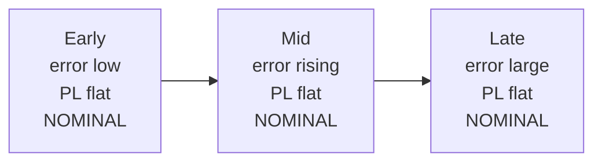
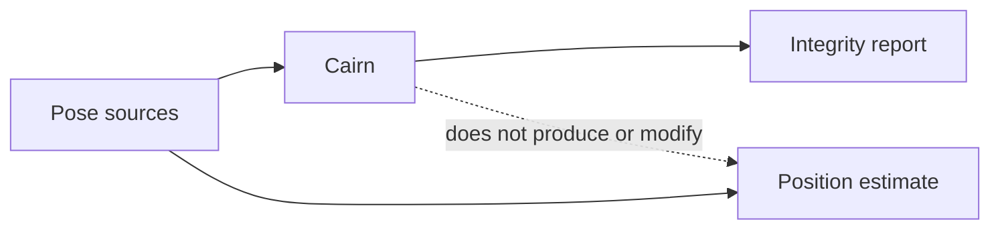

# Cairn

Cairn evaluates whether a robot’s positioning system is **telling the truth about its own uncertainty**. It measures silently wrong, overconfident poses on real underground trajectories and packages detectors that raise protection levels when geometry or cross-sensor consistency collapses.

## The problem

Modern SLAM and state estimators fail silently underground: self-similar corridors, dust, vibration, and degenerate LiDAR returns produce large position errors while the filter’s self-reported covariance stays tight. Downstream planners then treat a confidently wrong pose as safe. Cairn’s headline metric is the **missed-detection rate** — the fraction of epochs where true error exceeds the claimed protection level while the system still declares itself nominal.

## Installation

Requires Python 3.12+.

```bash
git clone https://github.com/GautamTalksDev/Cairn.git
cd Cairn
python -m venv .venv
source .venv/bin/activate   # Windows: .venv\Scripts\activate
pip install -e ".[dev]"
```

## Quickstart (< 15 minutes)

Bundled trajectories under `examples/quickstart/` are **synthetic** (generated by
`scripts/make_quickstart_data.py`): ~700 poses at 10 Hz on a corridor path with
turns, two noisy sources, and an injected drift segment so consistency monitoring
demonstrates a detection. Not CERBERUS; freely redistributable.

```bash
# Regenerate if needed (already committed for a fresh clone):
# python scripts/make_quickstart_data.py --seed 0

# 1) Integrate sample (two sources; watch state after drift onset)
python examples/integrate.py

# 2) Score est vs gt with the bundled integrity reports
cairn score \
  --est examples/quickstart/est.tum \
  --gt examples/quickstart/gt.tum \
  --reports examples/quickstart/reports.txt \
  --alert-limit 2.0 \
  --out outputs/quickstart

# 3) Optional: results table (uses quickstart when full data is absent)
python scripts/generate_results.py
```

Also: `python examples/custom_source.py` and `python examples/analyse_run.py`.

Open `outputs/quickstart/` for `summary.json`, `report.md`, and plots.

Full CERBERUS sequences (download yourself; InC-NC; never commit): see
[Data provenance](#data-provenance-and-licences) and `scripts/prepare_cerberus.py`.

## How silent failure looks

Watch true error climb while the reported state stays `NOMINAL` and the
protection level stays flat (the silent-failure pattern; our CompSLAM drift
demos use **synthetic** faults).



## What Cairn does in the stack

Follow the arrows: pose sources feed Cairn and also feed your position estimate;
Cairn emits an integrity report and does **not** write the position.



## Metric definitions

Let each epoch $k$ have true horizontal error $e_k$, horizontal protection level
$\mathrm{PL}_k$, and integrity state
$s_k \in \{\mathrm{NOMINAL},\mathrm{DEGRADED},\mathrm{DO\_NOT\_TRUST}\}$.

**Missed-detection rate (safety):**

$$
\mathrm{MDR}
= \frac{1}{N}\sum_{k=1}^{N}
\mathbf{1}\!\left[e_k > \mathrm{PL}_k \;\wedge\; s_k=\mathrm{NOMINAL}\right]
$$

**False-alarm rate (usability):**

$$
\mathrm{FAR}
= \frac{1}{N}\sum_{k=1}^{N}
\mathbf{1}\!\left[
s_k\in\{\mathrm{DEGRADED},\mathrm{DO\_NOT\_TRUST}\}
\;\wedge\;
e_k \le \mathrm{PL}_k
\right]
$$

**Availability:**

$$
\mathrm{Availability}
= \frac{1}{N}\sum_{k=1}^{N}
\mathbf{1}\!\left[s_k=\mathrm{NOMINAL}\right]
$$

**Naive protection level (CP-7):** from the estimator’s position covariance $C$,
with $\chi^2$ scaling at confidence $\gamma$ (default $99.9\%$):

$$
\mathrm{HPL}=\sqrt{\chi^2_{\gamma,2}\,\lambda_{\max}(C_{xy})},\qquad
\mathrm{VPL}=\sqrt{\chi^2_{\gamma,1}\,C_{zz}}
$$

State is always $\mathrm{NOMINAL}$ (no integrity monitoring).

**ATE RMSE:** after optional Umeyama SE(3) alignment, RMSE of Euclidean position error over time-associated poses.

## Current results

Full tables and regenerate commands live in [`RESULTS.md`](RESULTS.md).

**Drift detection (synthetic along-track drift on CompSLAM).** Consistency left
`NOMINAL` **12 s** after onset when true error was **0.54 m** (rolling 5 s alarm
duty ≥ 50%). A naive covariance monitor never alarmed, and error reached
**20.5 m**. These faults were injected synthetically; they are not
field-observed mine drift. Figure: [`docs/figures/drift_timing.png`](docs/figures/drift_timing.png).

**Sigma sweep on clean CompSLAM (naive baseline).** With a claimed diagonal σ,
MDR ≤ 0.1% is reachable near **σ\* ≈ 6.94 cm → HPL ≈ 0.258 m (~0.74× ATE)**.
That is *not* yet a “static covariance is useless” result on this one sequence;
treat the product case as provisional until multi-sequence + matched-FAR ROC.
Run `python scripts/sigma_sweep.py` (needs prepared `data/processed/`).

**Solution separation (synthetic independent sources).** Configured family-wise
$P_{FA}=0.05$, 2000 trials: empirical false-alarm rate 5.05%; injected lidar bias
isolated. See [`RESULTS.md`](RESULTS.md).

Historical CP-7 tables that used an assumed $\sigma_{xy}=5\,\mathrm{cm}$ (including
~15% naive MDR) are context only; see [docs/methodology.md](docs/methodology.md).

## Data provenance and licences

### Bundled quickstart (`examples/quickstart/`)

**Synthetic.** Generated by `scripts/make_quickstart_data.py` (default seed 0).
Corridor path with turns, noisy dual sources, injected along-track drift, and
consistency-monitor reports. Headers in each file say so. Regenerate anytime;
safe to redistribute under the repository Apache-2.0 license.

### Full CERBERUS sequences (optional evaluation only)

```bash
# After downloading anymal_N yourself from the CERBERUS libdrive share
# (In Copyright, Non-Commercial Use Permitted; never commit full dumps):
python scripts/prepare_cerberus.py data/raw/cerberus/anymal_1 --method compslam
python scripts/run_baseline.py data/processed/anymal_1_1_compslam
python scripts/run_degeneracy.py data/processed/anymal_1_1_compslam
```

CERBERUS DOI: [10.3929/ethz-b-000552248](https://doi.org/10.3929/ethz-b-000552248).
Catalogue: [cerberus_darpa_subt_datasets](https://github.com/leggedrobotics/cerberus_darpa_subt_datasets).

## Limitations (read before you cite this)

1. **CERBERUS TUM exports carry no covariance.** CP-7/CP-8 numbers use a **claimed** diagonal self-report ($\sigma_{xy}=5\,\mathrm{cm}$ by default). That is a realistic overconfident LIO prior, not the literal CompSLAM filter matrix. Changing $\sigma$ changes MDR a lot; regenerate RESULTS.md if you change it.
2. **CP-8 on trajectory-only bundles does not decode the 24 GB LiDAR bag.** Corridor localizability is obtained by aligning a precomputed ICP-Hessian corridor template with travel direction (straight → corridor, turn → corner). Synthetic cloud unit tests exercise the real Hessian detector; full-bag scan replay is future work.
3. **Solution separation assumes independent sources.** Shared maps, clocks, or degenerate geometry induce common-mode faults that SS can miss while still looking consistent. It is necessary, not sufficient.
4. **Umeyama alignment absorbs a global SE(3) bias** before integrity scoring. That is standard for ATE-style comparison but is not a substitute for aligned frames on a live robot.
5. **Single-fault, position-only SS.** Multi-fault isolation and full SE(3) fusion are not implemented.
6. **This is research scaffolding, not a certified integrity monitor.** No SIL/ASIL claim, no formal proof of missed-detection bounds, no warranty for field use.
7. **Bundled quickstart is synthetic** (not a CERBERUS subsample). Absolute
   percentages differ from full-rate CompSLAM evaluation; use it for demos and
   offline CI, not as field evidence.

## Project layout

```
src/cairn/           library (types, metrics, monitor, CLI)
examples/quickstart/ synthetic offline demo trajectories (make_quickstart_data.py)
scripts/             prepare_cerberus, make_quickstart_data, generate_results, …
tests/               unit / integration tests
RESULTS.md           auto-generated evidence table
LICENSE              Apache License 2.0
```

## Development

```bash
pip install -e ".[dev]"
pytest
ruff check src tests scripts
```

CI runs `ruff` and `pytest` on every push (see `.github/workflows/ci.yml`).
