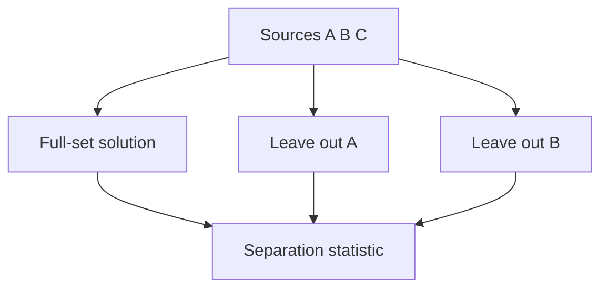
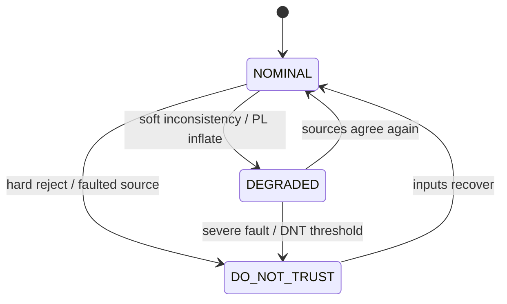

# Concepts

This note is for someone who already knows robotics and wants a clear picture of
integrity monitoring as Cairn uses it. Worked numbers come from the CERBERUS
CompSLAM experiments described in [methodology.md](methodology.md).

## Protection level versus covariance

A **covariance** is the estimator's own uncertainty claim: a 6×6 matrix over
position and small-angle attitude. An **error bar** drawn from that matrix is
still that claim. It answers "how uncertain do I say I am?"

A **protection level** (PL) is different. It is a distance bound, in metres,
that the integrity monitor asserts about true error at a configured integrity
risk. Horizontal PL (HPL) and vertical PL (VPL) are the usual pair. The safety
question is not whether the covariance looks small. It is whether
`true_error ≤ protection_level` whenever the monitor still says the solution is
usable.

Cairn reports HPL and VPL on every epoch. In `NOMINAL` operation you should treat
the published PL as the claim you are betting on. If true error exceeds that PL
while state remains `NOMINAL`, that epoch is a **missed detection**.

## Missed detection rate and false alarm rate

Fix a sequence of integrity reports and a matching true horizontal error per
epoch (metres).

**Missed detection rate (MDR)** is the fraction of epochs where

`true_error > protection_level` and `state == NOMINAL`.

Those are the silently wrong epochs: the monitor still looks happy while the
bound is already false. MDR is the safety-critical rate.

**False alarm rate (FAR)** is the fraction of epochs where the monitor leaves
`NOMINAL` (`DEGRADED` or `DO_NOT_TRUST`) while `true_error ≤ protection_level`.
Those are unnecessary alarms. FAR hurts usability and availability, but it does
not strand a planner on a confident lie the way MDR does.

Trade the two deliberately. A monitor that never alarms has FAR = 0 and can
still have large MDR (the naive covariance baseline on injected drift). A
monitor that abstains constantly can drive MDR down by refusing to claim
`NOMINAL`, at the cost of availability.

## Stanford diagram

The Stanford (or Stanford-ESA) integrity diagram plots true error against
protection level for each epoch, with an alert limit (AL) drawn as a vertical
or horizontal threshold in operations language. Reading the quadrants:

- **Nominal / available:** error and PL are both below the alert limit, and the
  PL still bounds the error. This is where you want most of the mass.
- **Misleading:** error exceeds PL while you still look available. That region
  is exactly the missed-detection problem.
- **Hazardously misleading:** the same failure with error past the alert limit.
  Ops would treat that as a hazard if the system still claimed integrity.
- **Unavailable:** the monitor has given up usable service (large PL or
  non-nominal state), so you are not claiming a tight safe bound.

Cairn's `stanford_diagram` and `cairn score` plots use that layout. When you
open `outputs/quickstart/stanford.png` after a score run, look first at how much
mass sits above the diagonal `error = PL` while state was still nominal.

## Solution separation and independence

With two or more pose sources in one navigation frame, Cairn can run
**solution separation** (the `consistency` monitor mode). It forms a full fused
position solution, then leave-one-out subset solutions. Large separations
relative to the separation covariance mean the left-out source disagrees with
the others. Protection levels rise; state can move to `DEGRADED` or
`DO_NOT_TRUST`. The report also tracks time since sources last corroborated each
other.

Look at the separation between the full-set solution and each leave-one-out
subset: that gap is the test statistic the consistency monitor thresholds.

The method rests on an **independence assumption**: faults should not hit every
source the same way at the same time. Cross-checks see disagreement. They do
not see a shared lie.

### Worked example: injected drift

On CompSLAM with along-track drift injected at 0.02 m/s from 30% into the run
(**synthetic**), consistency left `NOMINAL` **12.1 s** after onset when true
error was **0.54 m** (5 s alarm duty ≥ 50%). The naive covariance monitor never
left `NOMINAL`, and error grew to **20.5 m**. That is the README headline figure
in `docs/figures/drift_timing.png`. Numbers: [`RESULTS.md`](../RESULTS.md). The
point is that disagreement-capable monitoring can raise an alarm while a static
covariance claim stays quiet.

### Worked example: common mode

When the same **synthetic** drift is applied to **all** solution-separation
sources together, separations stay small. Measured missed-detection rate in that
trial is **73.2%**, with post-onset alarm fraction **9.0%**, versus **11.6%** MDR
and **97.4%** post-onset alarm fraction on a single-source control with the same
injected magnitude ([`RESULTS.md`](../RESULTS.md)). Solution separation is doing
what its assumption allows. It is not a detector for fully correlated corruption.

## Why availability matters

**Availability** here is the fraction of epochs with `state == NOMINAL`.

A monitor that is almost never nominal can post a flattering MDR by refusing to
claim integrity. That has not solved the navigation problem. The operator still
needs a usable stream.

Use your own product path as the reminder: consistency monitoring buys drift
detection on independent sources, but it also spends availability and can raise
false alarms relative to a naive baseline that is always nominal. On the
[`RESULTS.md`](../RESULTS.md) integrity table (claimed σ = 5 cm), degeneracy-aware
inflation already shows that pattern (MDR 15.08% → 10.59%, FAR 0% → 9.29%,
availability 100% → 90.71%). Judge a monitor by MDR **and** availability
together, not by MDR alone.

## Integrity states in one line

- `NOMINAL`: solution treated as usable under the published PL.
- `DEGRADED`: usable only with caution; PL inflated or consistency stressed.
- `DO_NOT_TRUST`: do not use the solution for safety-critical decisions.

Watch which edge fires: soft inconsistency moves you to `DEGRADED`; hard reject
or a clear faulted source moves you to `DO_NOT_TRUST`.

See [how-it-works.md](how-it-works.md) for a shorter API-oriented summary and
[limitations.md](limitations.md) for what these ideas do not buy you in the
field.
