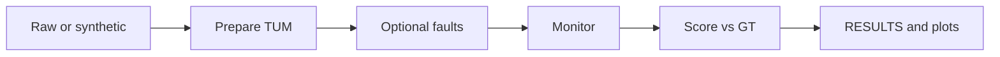

# Methodology

How every published number in this repository was produced, and how to reproduce
it. This is the document to attack if you are deciding whether to believe the
results.

Follow the pipeline left to right: raw or synthetic sequence → prepare →
optional fault injection → monitor → score → artifacts (`RESULTS.md`, plots).



## Dataset

Primary underground sequence: Team CERBERUS DARPA SubT Final Event, robot
`anymal_1`, CompSLAM estimate versus map-registered ground truth.

- Prepared tree: `data/processed/anymal_1_1_compslam/` (`est.tum`, `gt.tum`)
- Prepare from a local download: `python scripts/prepare_cerberus.py ...`
- Licence: In Copyright, Non-Commercial Use Permitted (InC-NC). See the README
  provenance table.
- Bundled `examples/quickstart/` is **synthetic** offline demo data from
  `scripts/make_quickstart_data.py` (corridor + drift). Full headline
  regeneration for CompSLAM still requires prepared trees under `data/processed/`.

CERBERUS TUM exports carry **no covariance**. Evaluation attaches a claimed
diagonal self-report (default σ_xy = σ_z = 0.05 m unless a sweep says otherwise).

## Alignment

True-error scoring uses trajectory association in time, then optional SE(3)
alignment:

- Default evaluation align mode: **Umeyama** (`evaluation.align_mode: umeyama`)
- Association windows: see `association.max_dt_s` and
  `association.alignment_max_dt_s` in config
- Umeyama removes global gauge freedom before ATE / integrity scoring. That is
  standard for offline comparison. It is not a substitute for known frames on a
  live robot.

ATE RMSE on the clean CompSLAM run used here is **0.3463 m** (see
[`RESULTS.md`](../RESULTS.md)).

## Integrity metrics

For each monitor report epoch, horizontal true error (metres) is paired with
horizontal protection level and integrity state.

- **MDR** = fraction of epochs with `error > HPL` and `state == NOMINAL`
- **FAR** = fraction with non-nominal state and `error ≤ HPL`
- **Availability** = fraction with `state == NOMINAL`

Stanford diagrams use the configured alert limit (default 2 m).

## Fault injection

Script: `scripts/inject_faults.py`. Faults edit `est.tum` only; ground truth is
unchanged. Outputs land under `data/processed/<source>_<fault>/` with metadata.

| Fault | Default idea | Default parameters |
| --- | --- | --- |
| `bias` | Constant XY offset on a mid-run window | window from ~40% for ~15% of the run |
| `dropout` | Freeze pose (dead-reckoning stall) | window from ~55% for ~8% of the run |
| `drift` | Along-track bias growing linearly | **0.02 m/s** from **30%** of the run |

Drift timing and common-mode papers in this repo use that drift family. All such
faults are **synthetic**. They demonstrate monitor response under controlled
corruption. They do not prove the same signatures appear in a mine.

## Detection timing metric

Script: `scripts/drift_timing.py`. Product declaration uses a **rolling 5 s
alarm duty ≥ 50%** after onset (`timing.duty_window_s`, `timing.duty_threshold`),
with `require_full_post_onset_window: true` so pre-onset FAR does not leak into
Δt.

Headline on CompSLAM + injected drift (consistency vs naive; **synthetic**;
numbers from [`RESULTS.md`](../RESULTS.md)):

- Consistency: duty-cycle detection at **12.1 s**, true error **0.54 m**
- Naive: never left `NOMINAL`; error reached **20.5 m**

Figure: `docs/figures/drift_timing.png` (from `outputs/drift_timing/`).

Duty-parameter sweeps live in `scripts/timing_robustness.py`.

## Common-mode experiment

Script: `scripts/common_mode_fault.py`. Applies the same synthetic drift to every
solution-separation source, versus a single-source control.

Published contrast (**synthetic**; from [`RESULTS.md`](../RESULTS.md)):

| Case | MDR | Alarm fraction after onset |
| --- | ---: | ---: |
| Common-mode (all sources) | 73.2% | 9.0% |
| Single-source control | 11.6% | 97.4% |

This is the measured independence failure mode, not an anecdote.

## Sigma sweep (naive baseline)

Script: `scripts/sigma_sweep.py`. Sweeps claimed diagonal σ for the naive
monitor on **clean** CompSLAM.

Finding used in limitations: MDR ≤ 0.001 is reachable near σ* ≈ **6.94 cm**,
implied HPL ≈ **0.258 m** (0.74× ATE **0.3463 m**). On this clean sequence a
well-tuned static covariance can already look adequate. That weakens any claim
that static covariance is useless without faults.

### Historical context: assumed σ = 5 cm tables

Early CP-7 / CP-8 tables (and older README drafts) reported naive MDR around
**15%** (for example 15.08% on prepared CompSLAM, or ~15.4% on a quickstart-only
regeneration) at a **claimed** $\sigma_{xy}=\sigma_z=5\,\mathrm{cm}$. That σ was
assumed because CERBERUS TUM exports carry no covariance; it is not CompSLAM’s
filter matrix. Those percentages are sensitive to the assumed σ and are easy to
misread as a field failure rate. Prefer the sigma-sweep crossing above and the
drift-timing headline in the README / [`RESULTS.md`](../RESULTS.md). Keep the
assumed-σ table in [`RESULTS.md`](../RESULTS.md) only as a regenerateable
artifact, not as the lead claim.

## Other published tables

| Artifact | Script | Notes |
| --- | --- | --- |
| Integrity table in RESULTS.md | `scripts/generate_results.py` | Prefers full CompSLAM if present; else quickstart |
| Drift / common-mode / sigma in RESULTS.md | Locked via `tests/golden/expected_results.json` | Embedded by `generate_results.py`; regenerate goldens only with an explained change |
| ROC / matched FAR | `scripts/roc_curve.py` | Fault and clean comparisons |
| Multi-sequence ranking | `scripts/run_all_sequences.py` | Needs multiple prepared trees |
| Degeneracy vs naive | `scripts/run_degeneracy.py` | Trajectory-template localizability on TUM-only bundles |
| Latency / RSS | `scripts/benchmark.py` | Microbenchmark, not integrity truth |
| End-to-end goldens | `pytest -m slow` | Locks headline numbers when data present |

## One-command reproduction

With prepared `data/processed/anymal_1_1_compslam/{est,gt}.tum`:

```bash
python scripts/reproduce_all.py --seed 0
```

Order: sigma sweep → fault injection → ROC → multi-sequence → drift timing →
timing sensitivity → common-mode → benchmark → `RESULTS.md`.

Pins:

- Master RNG seed default **0** (`CAIRN_RNG_SEED` / `--seed`)
- Writes `outputs/provenance.json` and `outputs/pip_freeze.txt`
- Fails loudly if the clean CompSLAM pair is missing (does not silently fall
  back to quickstart)

Quick demo without full data:

```bash
pip install .
python examples/integrate.py
python scripts/generate_results.py
cairn score \
  --est examples/quickstart/est.tum \
  --gt examples/quickstart/gt.tum \
  --reports examples/quickstart/reports.txt \
  --alert-limit 2.0 \
  --out outputs/quickstart
```

## How to attack these numbers

If you are skeptical, try at least:

1. Change claimed σ and re-run sigma sweep and RESULTS generation.
2. Change drift rate / onset fraction and re-run drift timing.
3. Re-run common-mode with a different shared bias schedule.
4. Disable Umeyama (`align_mode: none`) and compare MDR tables.
5. Swap in another sequence after `prepare_cerberus.py`.
6. Compare duty-threshold 0.5 versus raw first alarm (the scripts document why
   duty-cycle is the product metric).

If your attack changes the qualitative story (consistency still beats naive on
independent drift; common-mode still blinds SS), say so with the new parameters.
If it only moves the 12.1 s / 0.54 m point slightly, that is expected sensitivity,
not a silent invalidation.
